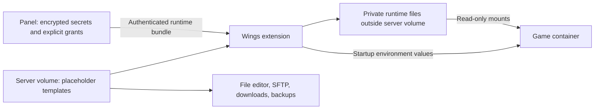

# Better Pelican Secrets: design

Date: 2026-10-20

Status: approved by the user on 2026-10-20 for implementation planning. The implementation plan requires its own review before execution.

Implementation plan: [task breakdown and verification](../plans/2026-10-20-better-pelican-secrets.md).

## 1. Purpose and success criteria

Build a Pelican Panel plugin that makes confidential game-server configuration easy to manage without putting actual values in ordinary startup forms and editable configuration files. A server gets a Secrets page; administrators get a cross-server management page. Explicit permissions govern who can list, reveal, create, update, delete, bind, and delegate access to secrets.

The same secret can supply an existing startup environment variable and references in arbitrary text configuration files. Examples include a CS2 RCON password, an API key in a nested JSON document, a YAML credential, and a .env value. Configuration support is generic and must not depend on a game-specific schema, editable-field allowlist, or per-game adapter.

Developers retain their normal code, configuration, and console access. The goal is to prevent ordinary direct exposure through management interfaces and source configuration, while preserving that workflow. Someone who can execute code inside the game server can potentially extract the secrets used by that server. Reviewing executable changes is the operator's detection process; the product does not prevent this kind of runtime extraction.

The first release succeeds when an operator can create one server-owned secret, grant selected users specific operations, bind it to a startup variable and multiple configuration files, restart normally, and observe the correct runtime values while ordinary editable files, file downloads, and backups retain placeholders.

## 2. Agreed scope

- Target Pelican Panel and Wings v1.0.0-rc.1 as an explicitly tested pair.
- Server-owned secrets first. Shared secrets across servers are a future extension, not part of this release.
- Generic UTF-8 text templates, including JSON, YAML, .env, and raw text, from the first release.
- Startup bindings assign a secret to a named existing egg environment variable.
- Secret and template changes apply on the next normal start or restart. Never restart a server automatically after a save.
- Show whether a server's current runtime differs from its desired configuration.
- Server owners and non-root administrators need explicit grants. Root administrators are trusted and have automatic authority.
- File and code editing remain available under existing Pelican permissions. Adding restrictions to executable uploads, safe JSON fields, or general console use is outside this design.
- A compatible node integration is part of the deployment, rather than assuming the Panel plugin alone can implement runtime file isolation.

This specification supersedes the strict developer restrictions in ADR-0001 and follows [ADR-0002](../../adr/0002-retain-developer-access-and-generic-file-support.md).

## 3. Trust boundary

### Protected surfaces

The product must keep secret values out of normal secret-list responses, template previews, ordinary startup-variable storage, configuration templates, ordinary file/SFTP downloads, archive/backup inputs derived from those templates, activity records, validation errors, and background-job payloads. Revealing a secret is a separate authorized action.

Protection applies to values managed by this plugin and its delivery paths. It cannot retrospectively remove a credential already present in an old backup, an unmanaged file, or a game-generated log.

### Trusted capabilities and limits

Root administrators, host/Docker operators, the Panel process, the Wings integration, and the game process are inside the trusted boundary. Administrators who can grant themselves root or execute code as the Panel are also effectively trusted. Ordinary owner/admin shortcuts must not grant secret actions by themselves.

Developers with code or unrestricted configuration access can redirect a request, change an executable, or make the game print a value. The product must state this clearly in its setup documentation. It must not advertise protection from hostile code running in the secret-consuming server.

The plugin must avoid printing values itself. Literal-value redaction before node logs/websocket delivery is an additional defense against common startup echoes, not a guarantee against transformed, encoded, fragmented, or application-controlled output. Applications can create their own plaintext artifacts; those are outside the source-template isolation guarantee.

## 4. Architecture and alternatives

### Selected design: Panel plugin plus a Wings extension

Use a normal Pelican plugin for the UI, encrypted storage, authorization, audit records, and desired configuration. Use a version-pinned Wings extension for pre-start secret retrieval, template rendering, runtime mounts, environment injection, and application-status reporting. Ship and document a reproducible patched Wings build based on rc.1; do not require a second privileged daemon alongside Wings.

The Panel sends references and desired revisions through normal configuration synchronization. It does not place plaintext secret values into the ordinary synchronized environment configuration. At every start, Wings obtains an authenticated, server-specific runtime bundle and uses it to render a start snapshot.

Original template files stay inside the ordinary server data volume. Rendered files live outside that volume in a private node runtime area and are bind-mounted over their configured paths inside the game container. This separation is the mechanism that keeps normal filesystem operations and backups on the placeholder source files.

### Alternatives considered

| Approach | Decision |
| --- | --- |
| Panel plugin writing plaintext into normal server files | Rejected: masking the editor would still leave normal file and backup paths containing values. |
| Panel plugin plus a custom game image/entrypoint | Possible for constrained images, but not selected as the generic arbitrary-path mechanism. It adds image-specific behavior and may echo resolved startup values. |
| Panel plugin plus version-pinned Wings extension | Selected: centralizes lifecycle handling and mounts runtime files separately without requiring game-specific renderers. It adds node deployment and maintenance work. |

Container mount lifecycle behavior is a proposed integration that must pass the release tests below. Source inspection establishes a plausible seam, not a completed compatibility proof.

## 5. Product experience

### Server Secrets page

The page has Secrets, File templates, and Startup bindings sections, plus an application-status summary. Users see only sections and actions authorized for them; the server checks every action independently of UI visibility.

A secret row shows its name, description, whether a value is set, version, last change, and binding count. Lists never include a value. Create/update forms accept a new value or generate a cryptographically random value; existing forms never prefill the actual value. Blank input preserves a stored value. Clearing/deleting requires a distinct action.

An intentionally empty value uses an explicit Set empty value action, distinct from leaving an update field blank or deleting the secret.

Reveal requires its own permission, is audited, and returns the value only in that action's non-cacheable response. There is no bulk-reveal endpoint or value-bearing default serialization.

### Setting up a file

1. Choose an existing server file or create a template using normal file permissions.
2. Choose the secret through a picker and insert a placeholder at the desired position. The picker offers only secrets the actor can bind.
3. Confirm the escaping mode, source path, and in-container destination. The normal destination is derived automatically from the server data mount; custom mappings require trusted configuration.
4. Validate and preview using harmless dummy values, then save the file registration and approved bindings.
5. Show Pending application until the next start reports the new revision as applied.

After registration, developers can edit ordinary surrounding text in the normal editor or through SFTP. The source remains a template. Saving through those paths does not reveal or resolve values. An external change that invalidates placeholders is reported during validation and prevents the next protected start until corrected.

The destination is a runtime configuration input. A game may read it normally; rewriting the mounted file is not supported in the first release. This limitation is visible when registering a file and in compatibility documentation. Formats are generic; application-specific file rewriting behavior still matters.

### Administrator page

Provide a cross-server list, server filter, desired/applied status, grant management, and metadata-only audit views. Root sees all servers. An ordinary administrator sees only the scope and actions explicitly granted to that administrator or its roles.

### Editing and grant changes

Replacing a secret creates a new version and marks affected servers pending. The running process keeps its current value until restart. Revoking a person's reveal permission blocks subsequent reveals immediately; it does not erase a value that person already learned. Disabling a binding takes effect on the next start. Never claim that revoking a UI grant revokes a credential at its external provider.

## 6. Template language and escaping

Templates are UTF-8 text with a small literal placeholder grammar. They are not Blade, shell scripts, expression engines, or recursively evaluated templates.

The simple form is `{{secret:NAME}}`. Each managed file has an explicitly selected output format (`json`, `yaml`, `dotenv`, or `text`) and default rendering mode. The picker inserts the correct token for that mode. Mixed-format files can specify a mode on an individual token: `{{secret:NAME|mode}}`.

Secret names are server-scoped, case-sensitive identifiers matching `[A-Z][A-Z0-9_]{0,63}`. Names are immutable in the first release, while descriptions and values can change. Binding records resolve names to immutable secret IDs. A token never performs a cross-server lookup.

| Mode | Expansion and placement |
| --- | --- |
| `json-string` | A complete JSON string value, including quotes and escaping. Place the token outside existing quotes. |
| `yaml-string` | A complete YAML 1.2 string scalar emitted with compatible JSON-style double-quoted escaping. Place the token outside existing quotes. |
| `dotenv` | A quoted dotenv value for the explicitly supported Laravel/phpdotenv-compatible dialect. Place after `KEY=` without outer quotes. Reject values the selected dialect cannot represent without changing meaning. |
| `raw` | Exact UTF-8 value bytes. The operator controls surrounding syntax. Do not perform shell expansion or infer quoting. |

For example, a JSON source contains `"apiKey": {{secret:API_KEY}}` with `json-string` selected; a YAML source contains `apiKey: {{secret:API_KEY}}` with `yaml-string` selected; and a dotenv source contains `API_KEY={{secret:API_KEY}}` with `dotenv` selected. These are template inputs, so a JSON source is not necessarily valid JSON until rendered. Show a template-aware editor and validate the rendered result with dummy values rather than treating an unresolved template as ordinary JSON.

The output format and default mode are suggested from the extension but must be confirmed when registering the file. Unknown formats use `text` with an explicitly selected `raw` mode. The file output format controls whole-document validation independently of individual token modes. Embedded-string interpolation uses an explicit raw token and is the operator's responsibility. Different .env/shell dialects are not interchangeable; generic raw mode remains available when the consumer does not use the supported dotenv grammar.

`{{!secret:NAME}}` produces the literal text `{{secret:NAME}}`. Inserted secret values are never scanned again, even if they contain placeholder-looking text. Unknown modes, malformed secret tokens, unknown names, and unapproved references fail validation; they are never silently replaced with empty strings.

The per-file approved binding manifest records each allowed secret ID/name, mode, and token occurrence count. Users with normal file access can change surrounding text, but adding/removing secret references or changing their modes requires bind permission and an updated manifest. A node-side mismatch blocks start. This is a syntactic binding check, not an attempt to prevent a developer from changing the meaning of executable code or configuration around an existing reference.

Names can be visible in source placeholders to anyone who can read that file. The list permission controls browsing the secret inventory; it is not a promise to conceal names already referenced by readable files. Names and descriptions must not contain actual confidential values.

## 7. Permissions and delegation

Use the following operations consistently on server and admin pages:

| Operation | Meaning |
| --- | --- |
| `list` | Browse secret metadata and names in an authorized scope. |
| `reveal` | Receive an actual stored value through an explicit reveal action. |
| `create` | Create a new secret in a server scope. |
| `update` | Replace a value or edit its description without automatically reading the old value. |
| `delete` | Delete an unbound secret. Bound secrets must be unbound first. |
| `bind` | Assign a secret to a managed file or existing startup variable, or change/remove that assignment. |
| `manage-access` | Grant or revoke permitted operations for other users within the actor's delegated authority. |

Register corresponding custom permissions with Pelican's admin-role and subuser interfaces. A plugin-specific authorizer is the authority for every value-bearing operation and configuration mutation. It must inspect explicit grants rather than relying on core owner/admin `can()` shortcuts or synthesized wildcard permissions.

Explicit permissions stored on an admin role can apply globally; explicit subuser permissions apply to that server. Plugin grant records add server-scoped user grants, including for owners who have no subuser row, and per-secret user grants. These sources are additive. A server-wide grant applies to all its secrets; a narrower per-secret grant does not revoke a broader grant. The UI must make inherited/broader access visible. There are no explicit-deny rules in the first release.

Per-secret grants cannot authorize creation of another secret; `create` is server-scoped. Binding requires `bind` on every referenced secret plus normal permission to edit the destination. Revealing requires `reveal`; binding never implies it. Any metadata needed by an action is limited to the action's authorized scope.

Starting an already approved plan needs the normal server power permission, not `bind` or `reveal`. Secret permissions control management and assignment, while the game is an authorized consumer of its approved bindings. Revoking a user's grant does not remove previously approved server bindings; an authorized manager must unbind or rotate those explicitly.

An actor needs `manage-access` and each operation it delegates in the same or a broader scope. It cannot elevate itself, grant global authority from a server grant, or delegate a reveal right it does not possess. Changes through native admin-role/subuser forms, plugin forms, and APIs must use the same checks. Root is the sole unconditional bypass.

Base server membership/visibility continues to apply on server pages. An explicit global admin secret permission enables its matching cross-server admin action. All lookups validate server and secret scope to prevent cross-server ID substitution.

## 8. Data and persistence

Keep plugin tables separate from normal `server_variables` storage:

- **Secrets:** immutable ID, server ID, immutable name, description, current version ID, creator, and timestamps. Enforce unique `(server_id, name)`.
- **Secret versions:** secret ID, version, encrypted value, actor, and timestamp. Values are encrypted using Laravel's authenticated encryption and the Panel APP_KEY, never returned through default model serialization.
- **Secret grants:** user, server or individual-secret scope, explicit operations, grantor, and timestamps. Native explicit admin-role/subuser permissions remain in their native stores and are read through authorizer adapters.
- **Managed files:** server ID, stable file ID, volume-relative source path, configured container destination, output format, default mode, approved binding manifest, validation status, and revision. Store no rendered value.
- **Startup bindings:** server ID, existing egg variable name, secret ID, and revision. Enforce one secret binding per environment name.
- **Desired plans:** monotonically increasing server revision, references to immutable secret versions, bindings, and validation metadata. Keep the reference plan separate from live node configuration.
- **Application records:** start attempt ID, node/server, desired/applied revision, source-template digests, version identifiers, timestamp, and success/error code. No values or rendered text.
- **Audit events:** actor, operation, scope, target IDs, timestamp, outcome, and request correlation ID. No values, previous values, runtime bundles, or value-derived hashes.

Initial limits are 64 KiB of UTF-8 per secret, 4 MiB per template, 1,000 references per template, and 256 managed files per server. Reject NUL-containing values that cannot be represented as environment variables. Limits are documented and configurable by trusted administrators. Unsupported encodings and binary templates produce explicit errors.

Normal startup-variable rows must not receive plugin-managed values. For a managed variable, the normal UI/API reports a bound-secret indicator and routes edits to the plugin's authorized action. Direct writes through other Panel surfaces must be rejected while the binding exists, rather than silently creating a second source of truth. Previously stored values require an explicit migration procedure.

Use APP_KEY backup and rotation procedures consistent with Laravel/Pelican. Retain versions needed by desired and currently applied records. Root may purge unreferenced historical versions; deleting a secret removes its stored versions after binding checks. Do not silently delete a needed version or fall back to an older credential when a new value is unavailable.

## 9. Node protocol and start lifecycle

### Configuration synchronization

The versioned node plan contains server identity, integration protocol version, desired revision, file and startup bindings, and secret-version references. Ordinary cached Wings configuration contains these references, not actual secret values. The node declares integration support and version compatibility before a server with bindings can start. Stock/incompatible nodes must refuse protected starts.

### Runtime bundle endpoint

The Wings extension makes a server-specific request over verified TLS using the existing trusted node identity plus a unique start-attempt ID and expected plan revision. The Panel verifies that the node currently owns that server and that the revision is still current. The response pins all referenced immutable versions as a single snapshot and includes only values needed by that server's approved plan.

This endpoint is node-only: browser users, client API tokens, and game containers cannot call it. Do not inject its credentials into the game environment. Set no-store responses, bound request sizes, and prohibit body logging. Node credentials remain a high-trust capability, equivalent to existing server-management authority on that node.

### Start sequence

1. Resolve the latest desired plan on every start, including schedule, console, and existing stopped-container paths.
2. Snapshot source templates from the server volume and verify canonical paths, sizes, UTF-8, manifest membership/counts, and destination validity.
3. Retrieve the corresponding immutable runtime bundle. A revision race causes a bounded retry against the new plan, not a mixed-version start.
4. Render all files in memory. Validate whole documents according to their registered JSON/YAML/dotenv output formats; text files receive syntax-independent checks only. Errors identify the file/reference without including actual values.
5. Recheck source digests before mounting. If a source changed during preparation, discard the attempt and retry once; repeated changes leave the server stopped with a clear retry message.
6. Write the complete rendered set to a private, per-server/start runtime area outside the server data tree. On Linux use a root-owned tmpfs area with restrictive directory permissions. Secret file ownership permits reading by the configured game UID; read-only bind mounts prevent game rewrites and do not require broadly readable host files.
7. Recreate the container when necessary so its mount list and environment match this exact start snapshot. Bind-mount rendered files read-only at their configured in-container paths. Preserve the original volume files underneath those mounts. Add actual startup values to the container environment immediately before creation.
8. Start the process only after every file and binding is ready. Mark the revision applied only after Docker accepts the configured start. A failure leaves a failed attempt and does not report the new revision as active.
9. Scrub application-owned in-memory bundle buffers when practical and retain the runtime files only while needed by the container. Clear temporary attempt artifacts on failures and after safe container teardown.

Changing files while the server runs marks its source digests dirty; it does not mutate the rendered runtime mount. A node watcher supplies prompt status and a digest comparison supplies the authoritative result at the next start. A restored/renamed file receives the same treatment. The next start uses the latest validated desired plan and templates.

Docker may persist environment values in root-accessible container metadata. The product's encrypted-at-rest promise applies to Panel secret storage and its own persisted plans, not to Docker internals or a trusted host operator's access. Never claim that runtime delivery eliminates every plaintext artifact on a trusted host.

### Paths and mount boundaries

Sources are normalized paths inside the configured server data root. Reject traversal, symlinks in managed source paths, special files, duplicate destinations, overlapping managed mounts, and targets outside trusted game-data mount mappings. Validate using file descriptors/canonical paths and recheck before container creation to limit path-swap races.

Default container destinations derive from the server's data-volume mapping. A path such as `/game/csgo/addons/s2script/configs/plugin-config.json` is supported when `/game` is a configured game-data mapping; it never means an arbitrary host path. Reject reserved system/runtime destinations and mount targets that would replace executables or node control files. Supporting arbitrary text formats does not authorize arbitrary host filesystem mounts.

## 10. Failure behavior and status

Missing secrets, invalid templates, unavailable/decryption-failed versions, node incompatibility, unauthorized references, unsafe paths, unreachable Panel, and failed mounts must prevent that protected start. Do not use empty strings, stale cached bundles, plaintext source files, or the last successful secret as an automatic fallback.

Already running servers continue when the Panel is temporarily unavailable. A new protected start needs a fresh runtime bundle. Expose this availability trade-off during installation.

The UI distinguishes desired revision, last successful applied revision, pending template edits, and last failed attempt. A save during a start creates a newer desired revision and remains pending even if the older pinned revision starts successfully. The status is an observation of configuration delivery; it is not a guarantee that the game accepted every setting.

User-facing failures contain actionable metadata such as `Unapproved reference API_KEY in configs/plugin.yaml`; they never interpolate values, rendered lines, response bodies, or exception dumps. Operators can correlate detailed metadata-only logs using the attempt ID.

## 11. File operations, backups, and lifecycle

- Native file editing, SFTP, downloads, and archives operate on template sources under the server data root. They never follow a runtime mount back into the game's mount namespace.
- Backup generation includes templates and non-secret binding metadata, not the private runtime area. Ordinary downloadable backups never contain encrypted/clear secret versions from the Panel database.
- Restoring a backup changes templates and marks the server pending; it does not recreate deleted secrets or grants. Validate all bindings before the next start.
- Server transfer sends templates and reference plans. Authenticate the destination node, render there on its next start, and clean old-node artifacts after safe teardown. Do not copy the runtime directory as server data.
- Server deletion removes bindings, grants, and stored secret versions through explicit lifecycle cleanup and destroys node runtime artifacts. Keep metadata-only audit history under the configured retention policy.
- Reinstall/image/egg changes retain desired secret metadata but invalidate compatibility/variable/path checks. They do not inject values into install scripts in the first release. An unknown or removed environment variable requires rebinding before a protected start.
- A node process restart clears/reconciles orphan runtime areas. Containers using lost tmpfs artifacts must be recreated safely; no protected restart may reuse an inaccessible or stale source.
- Disabling/uninstalling the plugin or node integration must not silently revert to ordinary plaintext behavior. Refuse destructive uninstall while bindings exist. Root must explicitly unbind/retire them first. Offline/absent Panel endpoints leave protected starts blocked.

Enabling this feature on an existing server does not erase old plaintext files, archives, logs, or backups. The setup flow identifies the migration boundary, replaces the source with placeholders only after explicit confirmation, and recommends credential rotation when prior exposure matters. It never reads actual values back into a general editor preview.

## 12. Components and responsibilities

| Component | Responsibility |
| --- | --- |
| Panel plugin registration | Pages, custom permissions, migrations, service bindings, compatibility checks. |
| Secret authorizer | Root exception, explicit native/plugin grants, scope validation, anti-escalation delegation. |
| Secret store | Encryption, immutable versions, metadata-only serialization, explicit reveal/update/delete. |
| Binding/plan service | Approved references, destination checks, desired revisions, immutable version snapshots. |
| Template compiler | Grammar, escaping, dummy preview, format validation; identical behavioral fixtures on Panel and node. |
| Node bundle controller | Node/server authentication, current revision validation, minimal no-store runtime response. |
| Panel interfaces | Server/admin pages, grant forms, native startup indicators, source-template editor, application status. |
| Wings extension | Start interception, snapshot validation, bundle retrieval, runtime mounts/environment, cleanup, status reporting. |
| Audit recorder | Metadata-only events for secret operations, grants, bindings, start delivery, and failures. |

Panel and node implementations share a versioned protocol and golden test fixtures rather than attempting to run PHP template code inside Wings. No general expression evaluator is required.

## 13. Verification and release acceptance

### Unit and integration coverage

- Permission matrix for every operation and actor type: root, ordinary admin, role-granted admin, owner without a grant, subuser, per-secret grantee, revoked user, and unrelated server user.
- Direct request, Livewire, native admin/subuser form, and API attempts must obey the same authority. Owner/admin wildcard shortcuts and self-escalating grant edits must fail.
- Secret lists, model serialization, exceptions, jobs, audit records, cached plans, and previews must contain no known fixture values. Reveal must be explicit, authorized, audited, and no-store.
- Renderer fixtures cover quotes, backslashes, Unicode, dollar signs, CR/LF, empty values, multiline values, token-like values, repeated tokens, literal-token escapes, malformed tokens, unsupported dotenv values, limits, and raw binary/NUL rejection.
- JSON/YAML outputs parse back to the exact original string. The supported dotenv loader reads the exact original value. Raw mode preserves the value without recursive expansion.
- Cross-server secret IDs/names, unknown references, extra/missing tokens, mode changes, path traversal, symlink/path swaps, duplicate mounts, and revision races must fail safely.

### Required live Linux acceptance environment

Run the pinned Panel/Wings pair with Docker, a test server image, SFTP, and a test backup target. Test fixtures use synthetic credentials, never production secrets. Current development tooling may need to be installed separately; documentation work does not establish a working PHP/Go/Docker environment.

1. One fixture secret renders correctly into a nested JSON value, YAML value, .env value, raw text, and an existing startup environment variable.
2. Read the template through the native editor, file API, signed download, SFTP, directory archive, backup/download/restore, and server transfer. Every ordinary copy retains placeholders and excludes runtime rendered files.
3. Inspect the container and confirm the game sees rendered values at the configured paths while the host server volume remains unchanged. Confirm read-only behavior is reported accurately.
4. Start from every supported path: first creation, stopped container, restart, scheduled action, Wings restart, and post-transfer. All must obtain a fresh plan/bundle and recreate stale environments/mounts when necessary.
5. Rotate a value while running: no automatic restart, old runtime remains active, pending status appears, and the next start applies one consistent new snapshot.
6. Revoke reveal access during a session: subsequent management requests fail, while the existing game runtime is not falsely reported as scrubbed.
7. Disconnect the Panel or make a value/template invalid: protected starts fail without plaintext/empty/stale fallback. Already running servers are unaffected.
8. Delete/restore/rename a source, change an egg/image, and interrupt startup/cleanup: status remains truthful and the next start validates rather than silently proceeding.
9. Verify a developer still has ordinary editing/code permissions. Deliberately run trusted test code that reads a runtime value and confirm documentation accurately describes this accepted limit.
10. Check controlled startup logging for literal redaction and prove it is documented as defense in depth, not a universal application-log guarantee.

The runtime-mount/start-lifecycle tests are release blockers. If rc.1 requires deeper Wings changes to make them pass, implement and document those changes; do not ship a Panel-only fallback under the same claims.

## 14. Rollout and maintenance

Distribute the Panel plugin with an exact compatibility declaration, node protocol version, reproducible Wings patch/build instructions, and tested release artifacts. Start on a non-production node and server. Compatibility checks must make a mixed stock/patched node fleet explicit before bindings are enabled.

Pin upstream code when testing. Pelican's internal services and Filament extension points are not a permanently stable plugin API, so every supported Panel/Wings update requires the permission, startup, file, and backup acceptance checks again.

Shared secrets can later add an explicit multi-server ownership/use policy above the existing immutable secret IDs and binding model. Do not allow cross-server name lookup or silently treat current server-owned secrets as global. Other future extensions include additional dotenv dialects, supported writable-runtime-file reconciliation, and application-specific reload controls; none are prerequisites for this first release.

## 15. Evidence and design assumptions

The links below support integration feasibility. The chosen lifecycle, protocol, grant adapters, and renderer behavior are this design's requirements and must be implemented/tested; upstream does not already provide the complete feature.

- [Official plugin documentation](https://pelican.dev/docs/panel/advanced/plugins/): plugin layout, server/admin extension points, custom permissions, and compatibility policy.
- [Panel rc.1 release](https://github.com/pelican/panel/releases/tag/v1.0.0-rc.1) and [Wings rc.1 release](https://github.com/pelican/wings/releases/tag/v1.0.0-rc.1): initial compatibility target.
- [Pinned Panel dependencies](https://github.com/pelican/panel/blob/v1.0.0-rc.1/composer.json): PHP/Laravel/Filament requirements for the selected release.
- [ServerPolicy](https://github.com/pelican/panel/blob/v1.0.0-rc.1/app/Policies/ServerPolicy.php) and [GetUserPermissionsService](https://github.com/pelican/panel/blob/v1.0.0-rc.1/app/Services/Servers/GetUserPermissionsService.php): core owner/admin shortcuts that explicit secret authorization must avoid.
- [EnvironmentService](https://github.com/pelican/panel/blob/v1.0.0-rc.1/app/Services/Servers/EnvironmentService.php) and [ServerConfigurationStructureService](https://github.com/pelican/panel/blob/v1.0.0-rc.1/app/Services/Servers/ServerConfigurationStructureService.php): environment/configuration delivery surfaces.
- [Wings container creation](https://github.com/pelican/wings/blob/v1.0.0-rc.1/environment/docker/container.go), [filesystem](https://github.com/pelican/wings/blob/v1.0.0-rc.1/server/filesystem/filesystem.go), and [backup flow](https://github.com/pelican/wings/blob/v1.0.0-rc.1/server/backup.go): the basis for separating runtime mounts from ordinary server storage.
- [SFTP handler](https://github.com/pelican/wings/blob/v1.0.0-rc.1/sftp/handler.go): native file access needs to remain on source templates rather than rendered runtime mounts.
- [Existing Secret Variables plugin](https://github.com/WisdomIT/pelican-secret-variables): related encrypted startup-variable work. This project does not assume it provides generic runtime-file templates or the required grant model.
